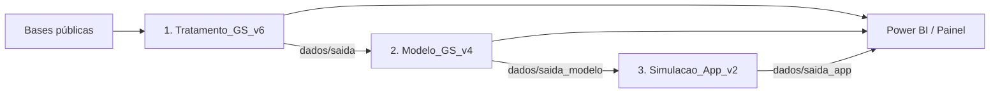

<p align="center">
  
</p>

<h3 align="center">Levando os direitos sociais até quem mais precisa, com dados e com quem está em campo.</h3>

<p align="center">
  <b>Global Solution 2026.2 · FIAP</b> · Desafio <b>CitizenTech</b> · Tecnologia em Data Science, 2º ano
</p>

<p align="center">
  <a href="https://karen-akemi.github.io/Caminho_dos_direitos/"><b>📊 Abrir o dashboard</b></a> ·
  <a href="https://www.figma.com/design/1eyGN1dPpd0AkRcqTDco4B"><b>🎨 Protótipo no Figma</b></a> ·
  <a href="#-status-da-entrega"><b>🎥 Pitch</b></a> ·
  <a href="#-status-da-entrega"><b>🖥️ Slides</b></a>
</p>

<p align="center">
  
  
  
  
</p>

<p align="center">
  👥 <b>Equipe:</b> Angelo Rabello · Karen Akemi de Oliveira · Milena Barbosa
</p>

---

## 📌 Sumário

- [O problema](#-o-problema)
- [A solução](#-a-solução)
- [Principais resultados](#-principais-resultados)
- [Dashboard interativo](#-dashboard-interativo)
- [Dados](#-dados)
- [Real, estimativa e simulado](#-real-estimativa-e-simulado)
- [Modelagem de dados](#-modelagem-de-dados)
- [Notebooks e como reproduzir](#-notebooks-e-como-reproduzir)
- [Estrutura do repositório](#-estrutura-do-repositório)
- [Status da entrega](#-status-da-entrega)

---

## ❓ O problema

Muitas pessoas que teriam direito a benefícios sociais não os recebem porque falta documento, porque o cadastro (como o CadÚnico) está desatualizado ou porque elas não sabem que têm o direito. Os agentes de saúde e os assistentes sociais são quem chega até essas pessoas, mas não têm uma ferramenta simples para identificar as pendências, orientar e encaminhar cada caso aos serviços (CRAS, cartório, Poupatempo, UBS).

## 💡 A solução

O **Caminho dos Direitos** aproxima pessoas em situação de vulnerabilidade dos benefícios sociais e dos documentos a que elas têm direito. O recorte é o **município de São Paulo**, nos seus 96 distritos. A solução tem três partes que conversam entre si:

<table>
<tr>
<td width="33%" valign="top">

### 📱 App do agente
*Protótipo no Figma*

Para agentes de saúde e assistentes sociais em campo. Gera o **Plano de Direitos** da pessoa, registra pendências e encaminha ao serviço certo.

</td>
<td width="33%" valign="top">

### 📊 Painel do monitoramento
*Power BI + versão HTML*

Para coordenadores e gestores públicos. Cruza o que o app coleta com os dados públicos do território e aponta **onde agir primeiro**.

</td>
<td width="33%" valign="top">

### 🧠 Modelo de priorização
*Python*

Estima onde há gente com **direito provável sem benefício**, calcula um índice de prioridade por distrito e recomenda campanhas.

</td>
</tr>
</table>

### 1. App do agente (protótipo de ideação)

O agente (de saúde ou do serviço social) é quem encurta a distância entre a população vulnerável e a rede de assistência (CRAS/SMADS).

- **Formulário de orientação:** a partir das respostas, o app gera o Plano de Direitos, uma lista de **possíveis benefícios** para a pessoa ou família, entre 7 programas: Documentação básica, CadÚnico, Bolsa Família, BPC, Tarifa Social de Energia, Pé-de-Meia e Farmácia Popular.
- **Identificação de pendências:** o agente marca a situação de cada benefício (*já recebe*, *bloqueado*, *precisa atualizar*, *falta documento*, *ainda não pediu*) e encaminha a pessoa ao serviço certo, avisando quais documentos levar.
- **Renda sem constrangimento:** no lugar de faixas em reais, uma calculadora (pessoas na casa + renda de cada uma) chega à renda por pessoa. O app guarda só a faixa, nunca o valor.
- **Anotação por voz com IA:** o agente dita suas observações e a IA transcreve e organiza as informações (necessidade de atendimento, dificuldade de locomoção etc.), filtrando dado clínico.
- **Lembretes por WhatsApp**, em texto e em **áudio**, como recurso de acessibilidade.
- **Acesso simples, sem gov.br:** o agente pede acesso com CPF e a unidade (UBS/CRAS) e o coordenador aprova. A entrada é por PIN de 6 dígitos ou código por WhatsApp.
- **Visão do coordenador** (no mesmo app): aba *Equipe* para aprovar ou recusar acessos e desligar agentes, visão dos casos da *Unidade* e transferência de casos entre agentes.

A ideia é ser um diferencial em relação ao e-SUS para os profissionais que trabalham em campo. O motor de regras do Plano de Direitos, a calculadora de renda, a anotação por voz e o lembrete por WhatsApp são demonstrados no notebook [`caminho_dos_direitos_colab_v3`](notebooks/caminho_dos_direitos_colab_v3.ipynb), com a persona **Dona Cida**, a mesma das telas do protótipo.

### 2. Painel do monitoramento

Responde a pergunta: **quem está sem documento ou sem direito, onde, e o que fazer primeiro?**

- 5 indicadores do app: pessoas acompanhadas, direitos sem acesso, pessoas sem documento, casos em área de risco e encaminhamentos concluídos;
- **mapa de prioridade** dos 96 distritos (urgente, alta, média, baixa);
- **Onde agir primeiro:** tabela que junta território (modelo) e o que o app registrou;
- situação dos direitos por programa, documentos que faltam e resultado dos encaminhamentos;
- **Quem tem direito e ainda não recebe:** mapa de calor por faixa de renda e faixa etária;
- **campanhas recomendadas**, só para distritos de prioridade **urgente** ou **alta**;
- **alertas cruzados**, regras que juntam um dado do território com o que o app registrou;
- **efetividade dos lembretes:** faltas nos encaminhamentos de quem recebeu lembrete (texto, áudio ou os dois) comparadas com as de quem não recebeu;
- **cobertura dos lembretes:** por faixa etária, quem recebe no próprio WhatsApp, no WhatsApp de um familiar, quem tem WhatsApp e não aceitou e quem não tem WhatsApp. Como não há dado público sobre lembretes, esses dois blocos usam premissas da simulação: mostram o que o painel vai medir, não um resultado;
- filtros: subprefeitura, distrito, unidade e programa;
- **segurança por linha** no Power BI: cada gestor vê apenas a sua subprefeitura.

### 3. Modelo de priorização

Compara cada distrito com os de perfil social parecido. Onde a cobertura de **BPC idoso** ou de **Bolsa Família** fica abaixo do esperado, estima quantas pessoas têm direito provável e não recebem. Depois calcula o **índice de prioridade (0 a 100)** e sugere campanhas só para os distritos urgentes e de prioridade alta.

---

## 📈 Principais resultados

> Resultados do modelo rodado com os dados públicos reais (selo **ESTIMATIVA**).

| | |
|---|---|
| 🎯 **10 distritos urgentes** | concentram **55%** das pessoas com direito provável sem benefício (cerca de 54.947 pessoas) |
| 📍 **Distritos mais prioritários** | Jardim Ângela (índice 79,0), Tremembé (76,2) e Grajaú (67,1) |
| 🗂️ **Classificação dos 96 distritos** | 10 urgentes · 19 alta · 29 média · 38 baixa |
| ⚠️ **Área de risco agrava** | quanto mais setores de risco R3/R4, mais gente com direito provável fica sem benefício por habitante (Spearman 0,23, significativo a 5%) |
| 🚌 **Distância ao CRAS** | não tem relação clara com a falta de benefício (Spearman 0,06, p = 0,55) |
| 🤖 **Qualidade do modelo** | BPC idoso: Random Forest com R² 0,81 (validação cruzada). Bolsa Família: R² 0,19, mais fraco, e por isso a lacuna do Bolsa Família é tratada como mais incerta |

---

## 📊 Dashboard interativo

<p align="center">
  <a href="https://karen-akemi.github.io/Caminho_dos_direitos/"><b>▶️ Abrir o Painel do monitoramento no navegador</b></a>
</p>

A versão HTML do painel roda direto no navegador, **sem baixar nada nem instalar o Power BI**: os filtros de subprefeitura, distrito, unidade e programa funcionam na própria página. O arquivo é autocontido ([`dashboard/index.html`](dashboard/index.html)) e é publicado pelo GitHub Pages.

O arquivo do Power BI também está no repositório: [`dashboard/Caminho-dos-direitos.pbix`](dashboard/Caminho-dos-direitos.pbix) (abre no Power BI Desktop).

<details>
<summary><b>Como publicar o dashboard no GitHub Pages</b></summary>

1. No repositório, vá em **Settings → Pages**.
2. Em **Build and deployment**, escolha **Deploy from a branch**, branch `main` e pasta `/ (root)`. Clique em **Save**.
3. Em 1 ou 2 minutos o painel fica no ar em `https://karen-akemi.github.io/Caminho_dos_direitos/`.

O `index.html` da raiz redireciona para o painel, então o link principal do Pages já abre o dashboard.

</details>

---

## 🗃️ Dados

O projeto usa **14 bases públicas e reais**, todas recortadas nos 96 distritos da cidade de São Paulo. A chave que liga tudo é o **distrito**.

| # | Base | Fonte | Referência | Uso no projeto |
|---|---|---|---|---|
| 1 | Limites dos 96 distritos | GeoSampa (Prefeitura) | Atual | Mapa e base de todos os cruzamentos |
| 2 | População total | IBGE, Censo 2022 | 2022 | Denominador por habitante |
| 3 | População por faixa etária | IBGE, Censo 2022 via TabNet SMS-SP | 2022 | Idosos de 65+ (base do BPC) |
| 4 | Famílias no CadÚnico (CSV) | SMADS | jan/2026 | CadÚnico por distrito |
| 5 | Famílias no CadÚnico (.ods) | Portal de Dados Abertos SP | jan/2026 | Conferência da base 4 |
| 6 | Famílias com Bolsa Família | Portal de Dados Abertos SP | 2025 | Cobertura do Bolsa Família |
| 7 | Beneficiários do BPC (idoso e PcD) | Portal de Dados Abertos SP | jul/2025 | Cobertura do BPC |
| 8 | CRAS | Geoportal SMADS | Atual | Distância ao CRAS, CRAS de referência |
| 9 | UBS | CNES (Ministério da Saúde) | Atual | Distância à UBS, unidade do agente |
| 10 | Cartórios de registro civil | Levantamento do grupo | 2026 | Distância ao cartório |
| 11 | Postos do Poupatempo | Levantamento do grupo | 2026 | Distância ao Poupatempo |
| 12 | Setores de risco geológico R1–R4 | GeoSampa | Atual | Zona de risco como agravante |
| 13 | Beneficiários da CDE (Tarifa Social) | ANEEL | 2024 | Testada e descartada (não traz a distribuidora da capital) |
| 14 | Crianças de até 5 anos sem registro | IBGE, Censo 2022 (SIDRA) | 2022 | Número da cidade (só existe por município) |

**Conferências feitas no tratamento:** 96 distritos sem nome repetido · população somada igual ao total do Censo (**11.451.999**) · as duas bases do CadÚnico iguais distrito a distrito (diferença 0) · todos os distritos com Bolsa Família, BPC e população de 65+.

📄 Detalhes de cada base, de como foram juntadas e das limitações: [`documentacao/Notebooks_e_bases_de_dados.pdf`](documentacao/Notebooks_e_bases_de_dados.pdf).

---

## 🏷️ Real, estimativa e simulado

O app é um **protótipo de ideação** e ainda não está em funcionamento. Por isso, no painel cada número leva um selo que diz de onde ele vem:

| Selo | O que é | Exemplos |
|---|---|---|
| **REAL** | Contado pelo governo ou medido direto nas bases públicas | Famílias no CadÚnico, coberturas de Bolsa Família e BPC, distâncias aos serviços, setores de risco |
| **ESTIMATIVA** | Calculado pelo modelo do grupo a partir dos dados reais | Pessoas com direito provável sem benefício, índice e classe de prioridade, campanhas e insights |
| **SIMULADO** | O que o app registraria, gerado no notebook `Simulacao_App_v2` | Pessoas acompanhadas, direitos sem acesso, documentos pendentes, encaminhamentos, lembretes e alertas |

Os dados simulados **não inventam as proporções**: 5.000 pessoas acompanhadas, distribuídas pelos distritos conforme o CadÚnico, com chances calibradas nos dados reais de cada distrito (cobertura real ÷ esperada pelo modelo, moradias em setores R3/R4, distância ao cartório, ao Poupatempo e ao serviço de destino). O que não tem dado público por distrito fica numa célula de premissas do notebook, para ser revisado. **Os dados de território são reais.**

<details>
<summary><b>Principais limitações</b></summary>

- As bases têm datas diferentes (2022, 2025, jan/2026).
- O CadÚnico por distrito não traz renda, o que deixa o modelo do Bolsa Família fraco (R² 0,19).
- A lacuna é relativa: mede quanto o distrito está abaixo dos parecidos, não conta pessoas elegíveis uma a uma.
- Não há dado de documentação por distrito; o mapa de pessoas sem documento usa a simulação.
- Os lembretes por WhatsApp são premissa: a diferença de faltas com e sem lembrete foi colocada na simulação.
- Não há base de agências do INSS; no encaminhamento do BPC, a distância ao INSS usa a do Poupatempo.
- A distância é medida do centro do distrito, o que não representa cada casa em distritos grandes (Marsilac, Parelheiros).
- Não há população com deficiência por distrito, então o modelo usa só o BPC idoso.

</details>

---

## 🧩 Modelagem de dados

A modelagem segue a sequência **conceitual → lógico → dimensional**, do que o agente registra no app até o painel.

- **Modelo dimensional:** Snowflake + Galaxy (constelação de fatos). São 7 tabelas fato com grãos diferentes que compartilham dimensões, e a hierarquia territorial (subprefeitura → distrito → unidade → caso) é normalizada para os filtros do painel.
- **Duas origens no mesmo modelo:** bases públicas (REAL e ESTIMATIVA DO MODELO) e dados do app (SIMULADO, gerados a partir dos dados reais). Elas se encontram no **distrito**, e a coluna `origem` identifica cada uma.

| Tipo | Tabelas |
|---|---|
| Dimensões | `dim_subprefeitura`, `dim_distrito`, `dim_equipamento`, `dim_programa`, `dim_caso`, `dim_tempo` (proposta em escala) |
| Fatos do território | `fato_indicadores_distrito`, `fato_recomendacoes`, `fato_risco_setor` |
| Fatos do app (SIMULADO) | `fato_item_plano` (um direito sugerido por caso, com a situação), `fato_documento_pendente`, `fato_encaminhamento` (destino, resultado e lembrete) |
| Fato que cruza app e território | `fato_alertas` |

- **Dados sensíveis ficam fora do modelo analítico:** login, PIN, pedidos de acesso, nomes de profissionais e telefones. A `dim_caso` não tem nome, apelido nem CPF; o painel só precisa do id.

📂 Modelo conceitual, modelo lógico, modelo dimensional, matrizes de granularidade e barramento e dicionário de dados: [`modelagem/`](modelagem/).

---|---|
| Dimensões | `dim_subprefeitura`, `dim_distrito`, `dim_equipamento`, `dim_programa`, `dim_caso` |
| Fatos do território | `fato_indicadores_distrito`, `fato_recomendacoes` |
| Fatos do app (SIMULADO) | `fato_item_plano` (um direito sugerido por caso, com a situação), `fato_documento_pendente`, `fato_encaminhamento` (destino e resultado: agendado, compareceu, concluído ou faltou), `fato_alertas` |

- **Dados sensíveis ficam fora do modelo analítico:** login, PIN, pedidos de acesso e nomes de profissionais. A `dim_caso` não tem nome, apelido nem CPF; o painel só precisa do id.

---

## 🐍 Notebooks e como reproduzir

Os notebooks rodam no **Google Colab** com o Google Drive. A trilha do dashboard roda em ordem; o notebook do app é independente.



| Ordem | Notebook | Para quê | Gera |
|---|---|---|---|
| 1 | [`Tratamento_GS_v6`](notebooks/Tratamento_GS_v6.ipynb) | Padroniza os nomes dos distritos, junta e confere as bases públicas | [`dados/saida/`](dados/saida) |
| 2 | [`Modelo_GS_v4`](notebooks/Modelo_GS_v4.ipynb) | Estima quem tem direito e não recebe, prioriza distritos e sugere campanhas | [`dados/saida_modelo/`](dados/saida_modelo) |
| 3 | [`Simulacao_App_v2`](notebooks/Simulacao_App_v2.ipynb) | Simula o que os agentes registrariam no app (casos, Plano de Direitos, documentos, encaminhamentos, lembretes por WhatsApp e alertas), calibrado nos dados reais e no modelo | [`dados/saida_app/`](dados/saida_app) |
| — | [`caminho_dos_direitos_colab_v3`](notebooks/caminho_dos_direitos_colab_v3.ipynb) | Demonstra o app: Plano de Direitos, calculadora de renda, testes, IA, anotação por voz e WhatsApp | — |

**Para rodar:** coloque as bases brutas na pasta `Meu Drive/Dados` e, em cada notebook, use **Ambiente de execução → Executar tudo**. O 2 só funciona depois do 1, e o 3 depois do 2, porque cada um lê os arquivos que o anterior gera. Os CSVs usam `;` como separador e vírgula decimal.

📄 Guia completo, com as bases, os arquivos de entrada, as saídas, o Power BI e os problemas comuns: [`documentacao/Notebooks_e_bases_de_dados.pdf`](documentacao/Notebooks_e_bases_de_dados.pdf).

---

## 📁 Estrutura do repositório

```
├── README.md
├── index.html                     # redireciona o GitHub Pages para o painel
├── assets/
│   └── logo.png
├── dashboard/
│   ├── index.html                 # Painel do monitoramento interativo (HTML autocontido)
│   └── Caminho-dos-direitos.pbix  # arquivo do Power BI
├── notebooks/
│   ├── Tratamento_GS_v6.ipynb      # 1. tratamento das bases públicas
│   ├── Modelo_GS_v4.ipynb          # 2. modelo de priorização e campanhas
│   ├── Simulacao_App_v2.ipynb      # 3. simulação dos dados do app
│   └── caminho_dos_direitos_colab_v3.ipynb   # demonstração do app
├── dados/
│   ├── saida/                     # território tratado (dimensões, acesso, risco, mapas)
│   ├── saida_modelo/              # indicadores, lacunas, recomendações e métricas do modelo
│   └── saida_app/                 # dados do app (SIMULADO)
├── documentacao/
│   └── Notebooks_e_bases_de_dados.pdf   # guia dos notebooks e das bases de dados
├── apresentacao/                  # 🚧 pitch e slides (em finalização)
└── modelagem/                     # 🚧 star schema (em finalização)
```

---

## ✅ Status da entrega

| Entrega | Status |
|---|---|
| Tratamento das bases públicas | ✅ Concluído |
| Modelo de priorização e recomendação de campanhas | ✅ Concluído |
| Simulação dos dados do app | ✅ Concluído |
| Painel do monitoramento (Power BI e versão HTML interativa) | ✅ Concluído |
| Protótipo do app no Figma | 🚧 Em finalização · [link atual](https://www.figma.com/design/1eyGN1dPpd0AkRcqTDco4B) |
| Modelo Dimensional (Snowflake + Galaxy) | 🚧 Em finalização |
| Slides | 🚧 Em finalização |
| Vídeo do pitch | 🚧 Em finalização |

---

## 🛠️ Tecnologias

**Python** (pandas, NumPy, scikit-learn, SciPy, statsmodels, GeoPandas, PySAL) no **Google Colab** · **Power BI** · **Figma** · **GitHub Pages**

---

<p align="center">
  <sub>FIAP · Global Solution 2026.2 · Disciplina de Data Visualization</sub>
</p>
