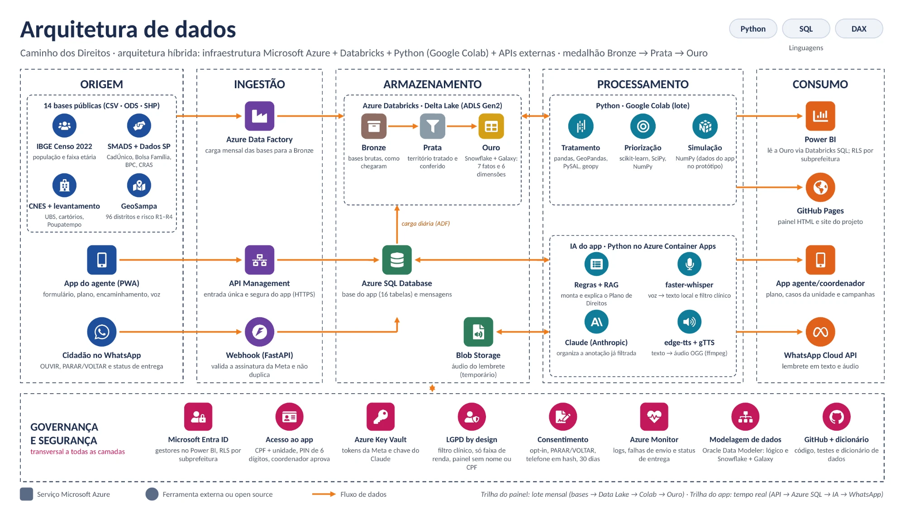

<p align="center">
  
</p>

<h3 align="center">Levando os direitos sociais até quem mais precisa, com dados e com quem está em campo.</h3>

<p align="center">
  <b>Global Solution 2026.2 · FIAP</b> · Desafio <b>CitizenTech</b> · Tecnologia em Data Science, 2º ano
</p>

<p align="center">
  <a href="https://karen-akemi.github.io/Caminho_dos_direitos/"><b>📊 Abrir o dashboard</b></a> ·
  <a href="https://karen-akemi.github.io/Caminho_dos_direitos/indexsite.html"><b>🌐 Site do projeto</b></a> ·
  <a href="https://karen-akemi.github.io/Caminho_dos_direitos/site/entrar.html"><b>🔐 Demo por cargo</b></a> ·
  <a href="https://karen-akemi.github.io/Caminho_dos_direitos/indexsite.html#prototipo"><b>📱 Protótipo do app</b></a> ·
  🎥 Pitch e 🖥️ Slides <sub>(🚧 em finalização)</sub>
</p>

<p align="center">
  
  
  
  
  
  
  
</p>

<p align="center">
  👥 <b>Equipe:</b> Angelo Rabello · Karen Akemi de Oliveira · Milena Barbosa
</p>

---

# Caminho dos Direitos

O **Caminho dos Direitos** aproxima pessoas em situação de vulnerabilidade dos benefícios sociais e dos documentos a que elas têm direito. Ele junta um **app para os agentes em campo**, um **painel para coordenadores e gestores** e um **modelo de priorização** que mostra onde agir primeiro nos 96 distritos do município de São Paulo.

## 📌 Sumário

- [Sobre o Projeto](#-sobre-o-projeto)
- [Funcionalidades](#️-funcionalidades)
- [Arquitetura](#️-arquitetura)
- [Privacidade e LGPD](#-privacidade-e-lgpd)
- [Tecnologias Utilizadas](#️-tecnologias-utilizadas)
- [Demonstração](#-demonstração)
- [Função dos notebooks](#-função-dos-notebooks)
- [Como rodar](#️-como-rodar)
- [Estrutura do Projeto](#-estrutura-do-projeto)
- [Equipe e Colaboradores](#-equipe-e-colaboradores)
- [Referências](#-referências)
- [Licença](#-licença)

## 📖 Sobre o Projeto

- **Problema:** muitas pessoas que teriam direito a benefícios sociais não os recebem. Falta documento, o cadastro (como o CadÚnico) está desatualizado ou elas não sabem que têm o direito.
- **Motivação:** os agentes de saúde e os assistentes sociais são quem chega até essas pessoas. Mas eles não têm uma ferramenta simples para identificar as pendências, orientar e encaminhar cada caso aos serviços (CRAS, cartório, Poupatempo, UBS). Os sistemas que eles já usam registram o atendimento, mas não mostram quais documentos e benefícios a família ainda não tem nem para onde encaminhar cada caso. O Caminho dos Direitos cobre esse espaço.
- **Como chegamos ao tema:** uma pesquisa exploratória com moradores e profissionais da linha de frente ajudou o grupo a definir o problema. Os números do projeto vêm das bases públicas. Os detalhes estão em [`pesquisa/`](pesquisa/README.md).
- **Objetivo principal:** responder **quem está sem documento ou sem direito, onde, e o que fazer primeiro**. Para isso, o projeto cruza o que o app registra com os dados públicos do território.
- **Público-alvo:**
  - agentes de saúde e assistentes sociais em campo, que usam o app;
  - coordenadores e gestores públicos, que usam o painel;
  - famílias em situação de vulnerabilidade, que são atendidas por eles.

## ⚙️ Funcionalidades

**📱 App do agente** (protótipo de ideação no Figma)
- **Plano de Direitos:** a partir de um formulário, o app lista os **possíveis benefícios** da pessoa ou da família entre 7 programas: Documentação básica, CadÚnico, Bolsa Família, BPC, Tarifa Social de Energia, Pé-de-Meia e Farmácia Popular.
- **Pendências e encaminhamento:** o agente marca a situação de cada benefício (*já recebe*, *bloqueado*, *precisa atualizar*, *falta documento*, *ainda não pediu*). Depois encaminha a pessoa ao serviço certo, com a lista de documentos para levar.
- **Renda sem constrangimento:** uma calculadora (pessoas na casa + renda de cada uma) chega à renda por pessoa. O app guarda só a faixa, nunca o valor.
- **Anotação por voz com IA:** a IA transcreve o que o agente fala e remove o dado clínico. Depois organiza a visita e sugere marcações, que o agente confirma.
- **Lembretes por WhatsApp**, em texto e em **áudio**, como recurso de acessibilidade.
- **Acesso simples, sem gov.br:**
  - o agente pede acesso com CPF e a unidade (UBS/CRAS);
  - o coordenador aprova o pedido;
  - a entrada é por PIN de 6 dígitos ou por código no WhatsApp.
- **Visão do coordenador:** aprovar ou recusar acessos, ver os casos da unidade e transferir casos entre agentes.

**📊 Painel do monitoramento** (Power BI e versão HTML), em duas abas, uma para cada público:
- **Gestão** (coordenação, subprefeituras e órgãos públicos):
  - **indicadores com meta** e sinal de *dentro da meta*, *atenção* ou *fora da meta*: encaminhamentos concluídos, faltas, pessoas sem documento já atendidas, tempo até concluir e pessoas que recebem lembrete;
  - **evolução no tempo**: por mês, quantas pessoas chegaram sem documento (ou quantos encaminhamentos foram feitos), quantas já foram atendidas e quantas aguardam, e há quanto tempo esperam;
  - **mapa de prioridade** e **Onde agir primeiro**, com a explicação do índice (0 a 100) e de quanto cada critério soma na nota de cada distrito;
  - situação dos direitos por programa, quem tem direito e não recebe, **alertas cruzados** e efeito dos lembretes.
- **Operação** (UBS, CRAS e agentes de campo):
  - quem está esperando há mais de 30 dias (com meta), agendados e faltas para remarcar;
  - ritmo da equipe nas últimas 12 semanas (casos novos × pendências resolvidas);
  - **fila de trabalho**: cada pessoa com pendência, há quanto tempo espera e o próximo passo;
  - documentos que faltam, encaminhamentos por destino e alertas do território.
- **Filtros** por subprefeitura, distrito, unidade e programa. No Power BI, cada gestor vê só a sua subprefeitura.
- Na versão HTML, a segurança por linha é simulada pela URL: `dashboard/?sub=M'Boi Mirim&travar=1` ou `dashboard/?uni=410&travar=1` travam o filtro (é o que a demo por cargo usa). `&aba=gestao` ou `&aba=operacao` escolhem a aba.
- As definições de cada indicador e as metas estão em [`dashboard/README.md`](dashboard/README.md).

> ⚠️ **Dados do app são simulados.** O app ainda não está em uso. Os indicadores de casos, pendências, encaminhamentos e alertas do painel vêm de [`Simulacao_App_v2`](notebooks/Simulacao_App_v2.ipynb), calibrado nos dados reais e no modelo (pasta `dados/saida_app/`). Os dados do território e do modelo vêm das bases públicas.

**🧠 Modelo de priorização** (Python)
- **Direito provável sem benefício:** compara cada distrito com os de perfil social parecido. Assim estima quantas pessoas têm direito provável a **BPC idoso** ou **Bolsa Família** e não recebem.
- **Índice e campanhas:** calcula um **índice de prioridade (0 a 100)** e sugere campanhas.
- **Resultado do modelo:**
  - os **10 distritos urgentes** concentram **55%** dessas pessoas (cerca de 54.947);
  - os mais prioritários são Jardim Ângela, Tremembé e Grajaú.
- **Qualidade do modelo** (validação cruzada com 5 partes, repetida 5 vezes; [`metricas_modelo.csv`](dados/saida_modelo/metricas_modelo.csv)):

  | Alvo | Modelo escolhido | R² | Erro médio (MAE) |
  |---|---|---|---|
  | Taxa de BPC idoso | Random Forest | 0,81 (± 0,02) | 2 p.p. |
  | Cobertura do Bolsa Família | Regressão linear (Ridge) | 0,19 (± 0,03) | 5 p.p. |

  A estimativa do BPC é confiável. A do Bolsa Família explica pouco da variação entre os distritos e por isso pesa como indicativo: o índice de prioridade não depende só dela, e a análise de sensibilidade mostra que o ranking se mantém estável.

## 🏗️ Arquitetura

A arquitetura proposta é **híbrida**. A infraestrutura roda na **Microsoft Azure** com **Azure Databricks** e camadas medalhão (Bronze → Prata → Ouro). O processamento e os modelos são em **Python**, e a solução usa APIs externas onde elas são a melhor opção (WhatsApp Cloud API e Claude).

<p align="center">
  
</p>

- **Trilha do painel (lote mensal):** as bases públicas entram pelo Azure Data Factory, são tratadas e passam pelo modelo. Depois viram o modelo dimensional que o Power BI lê.
- **Trilha do app (tempo real):** o app grava o atendimento no Azure SQL Database, a IA organiza a anotação e o lembrete sai pelo WhatsApp.
- **Governança:** Microsoft Entra ID com segurança por linha por subprefeitura, Azure Key Vault para os segredos e Azure Monitor para logs e alertas.

No protótipo, o processamento roda no Google Colab e o painel no GitHub Pages. A explicação camada por camada e o caminho até a produção estão em [`arquitetura/README.md`](arquitetura/README.md).

## 🔒 Privacidade e LGPD

O projeto guarda só o necessário para encaminhar cada caso:

- **Renda:** a calculadora mostra a renda por pessoa, mas o app guarda só a faixa, nunca o valor.
- **Anotação por voz:** a IA remove o dado clínico antes de qualquer outro passo. Ao salvar, o áudio é apagado e o texto é descartado. Ficam só as marcações que o agente confirmou.
- **IA externa:** o Claude recebe apenas o texto já filtrado.
- **WhatsApp:** o telefone é guardado como hash, e o cidadão pode responder PARAR para não receber mais lembretes.
- **Acesso:** cada gestor vê só a sua subprefeitura, e o coordenador aprova quem entra.
- **Segredos:** tokens e chaves ficam nos Secrets do Colab (no protótipo) ou no Azure Key Vault (na arquitetura proposta), nunca no código.

## 🛠️ Tecnologias Utilizadas

- **Front-end:**
  - **Figma**, para o protótipo do app;
  - **HTML, CSS e JavaScript**, para o painel interativo e o site do projeto, publicados no **GitHub Pages**.
- **Back-end:**
  - **Python** no **Google Colab**;
  - **FastAPI** com **Cloudflare Tunnel**, para o servidor do WhatsApp;
  - **WhatsApp Cloud API** (Meta).
- **Banco de dados e modelagem:**
  - **Oracle SQL Developer Data Modeler**, para o modelo conceitual, o lógico e o dimensional (Snowflake + Galaxy), com scripts SQL;
  - no protótipo, os dados tratados ficam em CSV.
- **Arquitetura proposta (Microsoft Azure):**
  - Azure Data Factory, Azure Databricks (Delta Lake), Azure SQL Database e Azure Blob Storage;
  - Azure API Management, Microsoft Entra ID, Azure Key Vault e Azure Monitor.
- **Outras ferramentas:**
  - **Power BI**;
  - **IA:** Whisper para a transcrição, Claude (Anthropic) para a explicação com RAG e para organizar a anotação, edge-tts e gTTS para as vozes;
  - **bibliotecas de dados:** pandas, NumPy, scikit-learn, SciPy, statsmodels, GeoPandas e PySAL.

## 🚀 Demonstração

| | Link |
|---|---|
| 📊 **Painel do monitoramento** (interativo, sem baixar nada) | [Abrir no navegador](https://karen-akemi.github.io/Caminho_dos_direitos/) · [arquivo do Power BI](dashboard/Caminho-dos-direitos.pbix) |
| 🌐 **Site do projeto** | [Abrir o site](https://karen-akemi.github.io/Caminho_dos_direitos/indexsite.html) |
| 🔐 **Demo por cargo** (login simulado: secretaria, subprefeitura, coordenação e agente) | [Entrar na demo](https://karen-akemi.github.io/Caminho_dos_direitos/site/entrar.html) |
| 📱 **Protótipo do app** | [Ver as telas no site](https://karen-akemi.github.io/Caminho_dos_direitos/indexsite.html#prototipo) |
| 🎬 **Vídeos das funções de IA** | [Ver abaixo](#-vídeos-de-demonstração) |
| 🎥 **Pitch** e 🖥️ **Slides** | 🚧 Em finalização |

## 🐍 Função dos notebooks

Os notebooks rodam no **Google Colab** com **Ambiente de execução → Executar tudo**. Eles estão divididos em duas trilhas.

| Trilha | Notebook | Principais funcionalidades |
|---|---|---|
| Dashboard · 1 | [`Tratamento_GS_v6`](notebooks/Tratamento_GS_v6.ipynb) | Padroniza os 96 distritos, junta e confere as bases públicas |
| Dashboard · 2 | [`Modelo_GS_v4`](notebooks/Modelo_GS_v4.ipynb) | Estima quem tem direito e não recebe, prioriza os distritos e sugere campanhas |
| Dashboard · 3 | [`Simulacao_App_v2`](notebooks/Simulacao_App_v2.ipynb) | Simula o que os agentes registrariam no app, calibrado nos dados reais e no modelo |
| App | [`caminho_dos_direitos_colab_v4`](notebooks/caminho_dos_direitos_colab_v4.ipynb) | Demonstra o app com a persona Dona Cida. Mostra o Plano de Direitos, os testes, a explicação com IA (RAG), a calculadora de renda, a anotação por voz e o lembrete |
| App | [`anotacao_por_voz`](notebooks/anotacao_por_voz.ipynb) | Transcreve a fala, remove o dado clínico, resume a visita e sugere marcações que o agente confirma |
| App | [`servidor_whatsapp_colab`](notebooks/servidor_whatsapp_colab.ipynb) | Envia o lembrete por WhatsApp de verdade, em texto e em mensagem de voz |

Na trilha do dashboard, o 2 só funciona depois do 1, e o 3 depois do 2. A trilha do app é independente. O guia seção por seção está em [`notebooks/README.md`](notebooks/README.md).

### 🎬 Vídeos de demonstração

Clique na imagem para assistir.

<table>
<tr>
<td align="center" width="50%" valign="top">
<a href="https://karen-akemi.github.io/Caminho_dos_direitos/assets/videos/anotacao_app.mp4"></a><br>
<b>🎙️ Anotação por voz com IA</b> <sub>(29 s)</sub>
</td>
<td align="center" width="50%" valign="top">
<a href="https://karen-akemi.github.io/Caminho_dos_direitos/assets/videos/lembrete_whatsapp.mp4"></a><br>
<b>💬 Lembrete por WhatsApp</b> <sub>(36 s)</sub>
</td>
</tr>
<tr>
<td valign="top">

Tela do app no caso da **Dona Cida**, gerada pelo notebook [`anotacao_por_voz`](notebooks/anotacao_por_voz.ipynb). O agente grava a anotação da visita e o app:

- mostra a transcrição, com o trecho de saúde já removido pela IA;
- sugere as marcações (dificuldade de se locomover, precisa de atendimento médico, precisa de acompanhante, melhor horário: à tarde), que o agente pode tirar ou adicionar;
- propõe próximos passos, como remarcar o Poupatempo para a tarde e confirmar com o filho;
- ao salvar, guarda só as marcações em `fato_necessidade_caso.csv`, apaga o áudio e descarta o texto.

</td>
<td valign="top">

O lembrete chegando a um celular de verdade, pela Cloud API da Meta, enviado pelo notebook [`servidor_whatsapp_colab`](notebooks/servidor_whatsapp_colab.ipynb):

- mensagem em texto para a **Dona Cida**: atendimento no Poupatempo M'Boi Mirim em 18/11, às 9h, levando certidão de nascimento, RG e comprovante de residência, como na tela de encaminhamento do protótipo;
- a opção de responder PARAR para não receber mais;
- em seguida, a **mensagem de voz** com o mesmo lembrete, como recurso de acessibilidade.

</td>
</tr>
</table>

## ▶️ Como rodar

**Painel e site:** não precisam de instalação. Basta abrir os links da [Demonstração](#-demonstração) ou abrir `dashboard/index.html` e `indexsite.html` direto no navegador, porque os dados já vêm junto das páginas. Se os dados de `dados/` mudarem, gere de novo os arquivos de dados do painel e do site:

```bash
python dashboard/gerar_dados_painel.py
```

```bash
python site/gerar_dados_site.py .
```

**Notebooks:**

1. Copie para uma pasta do seu Google Drive a pasta `dados/` e as pastas `notebooks/simulador/` e `notebooks/ia/`. As bases públicas originais (seção [Referências](#-referências)) também precisam estar no Drive. Localmente, o grupo as guarda em `para_o_colab/`, que não vai para o GitHub.
2. Abra o notebook no Google Colab e ajuste o caminho da pasta do projeto na seção de configuração (variável `PROJETO`).
3. Rode com **Ambiente de execução → Executar tudo**, respeitando a ordem da trilha do dashboard (1 → 2 → 3).

**Chaves (opcionais):** cadastre nos **Secrets do Colab**, nunca no código. Sem elas, os notebooks rodam em modo demonstração e nada é enviado para fora.

| Segredo | Para quê |
|---|---|
| `ANTHROPIC_API_KEY` | Explicação com IA e organização da anotação por voz |
| `WHATSAPP_TOKEN` e `WHATSAPP_PHONE_ID` | Lembrete por WhatsApp no notebook do app |
| `WA_VERIFY_TOKEN`, `WA_APP_SECRET`, `WA_ACCESS_TOKEN` e `WA_PHONE_ID` | Servidor do WhatsApp (webhook) |

O passo a passo de cada notebook está em [`notebooks/README.md`](notebooks/README.md).

## 📁 Estrutura do Projeto

```
├── README.md
├── index.html                     # abre o painel no GitHub Pages
├── indexsite.html                 # site de apresentação do projeto
├── site/
│   ├── entrar.html                # login simulado: escolha do cargo
│   ├── plataforma.html            # plataforma por cargo (secretaria, subprefeitura, coordenação, agente)
│   ├── plataforma.js · site.js · site.css
│   ├── dados_site.js              # dados do site, gerados a partir de dados/
│   └── gerar_dados_site.py        # gera o dados_site.js (python site/gerar_dados_site.py .)
├── assets/
│   ├── logo.png
│   ├── telas/                     # telas do protótipo do app
│   └── videos/                    # vídeos de demonstração (anotação por voz e WhatsApp)
├── dashboard/
│   ├── index.html                 # painel interativo (HTML), abas Gestão e Operação
│   ├── dados_painel.js            # dados do painel, gerados a partir de dados/
│   ├── gerar_dados_painel.py      # gera o dados_painel.js (python dashboard/gerar_dados_painel.py)
│   ├── README.md                  # indicadores, metas e como replicar no Power BI
│   └── Caminho-dos-direitos.pbix  # arquivo do Power BI
├── notebooks/
│   ├── Tratamento_GS_v6.ipynb
│   ├── Modelo_GS_v4.ipynb
│   ├── Simulacao_App_v2.ipynb
│   ├── caminho_dos_direitos_colab_v4.ipynb
│   ├── anotacao_por_voz.ipynb
│   ├── servidor_whatsapp_colab.ipynb
│   ├── simulador/                 # motor de regras do Plano de Direitos (regras, testes e RAG)
│   ├── ia/                        # anotação por voz, voz e WhatsApp
│   └── README.md                  # guia dos notebooks
├── dados/
│   ├── saida/                     # território tratado
│   │   └── extras/                # índice IDA por distrito (base auxiliar)
│   ├── saida_modelo/              # indicadores, lacunas, recomendações e métricas do modelo
│   └── saida_app/                 # dados do app (SIMULADO)
├── arquitetura/
│   ├── arquitetura_dados.png      # diagrama da arquitetura na Azure
│   └── README.md                  # explicação camada por camada
├── modelagem/                     # modelos conceitual, lógico e dimensional e dicionário de dados
├── pesquisa/                      # pesquisa exploratória que orientou a escolha do tema
├── documentacao/
│   └── Notebooks_e_bases_de_dados.pdf   # guia dos notebooks e das bases de dados
└── apresentacao/
    ├── guia_banca_ml.md           # guia de estudo para a banca de Machine Learning
    └── README.md                  # 🚧 pitch e slides (em finalização)
```

## 👥 Equipe e Colaboradores

| Integrante | Links |
|---|---|
| Angelo Rabello | [GitHub](https://github.com/AngeloRBLL0) |
| Karen Akemi de Oliveira | [GitHub](https://github.com/Karen-Akemi) |
| Milena Barbosa | [GitHub](https://github.com/MiihDev) |

## 📚 Referências

O projeto usa **14 bases**, recortadas nos 96 distritos da cidade de São Paulo: 12 bases públicas e 2 levantamentos do grupo.

**Bases públicas (12)**

1. **GeoSampa:** limites dos 96 distritos;
2. **GeoSampa:** setores de risco geológico (R1 a R4);
3. **IBGE, Censo 2022:** população total por distrito;
4. **IBGE, Censo 2022:** população por faixa etária (via TabNet SMS-SP);
5. **IBGE, Censo 2022 (SIDRA):** crianças de até 5 anos sem registro de nascimento;
6. **SMADS:** famílias no CadÚnico por distrito (jan/2026);
7. **Geoportal SMADS:** localização dos CRAS;
8. **Portal de Dados Abertos da Prefeitura de São Paulo:** famílias no CadÚnico (jan/2026);
9. **Portal de Dados Abertos da Prefeitura de São Paulo:** famílias com Bolsa Família (2025);
10. **Portal de Dados Abertos da Prefeitura de São Paulo:** beneficiários do BPC (jul/2025);
11. **CNES (Ministério da Saúde):** localização das UBS;
12. **ANEEL:** beneficiários da Tarifa Social de Energia (testada e descartada).

**Levantamentos do grupo (2)**

13. cartórios de registro civil da capital (2026);
14. postos do Poupatempo da capital (2026).

**Referência técnica:** documentação da WhatsApp Cloud API (Meta), base do servidor de lembretes.

Os detalhes de cada base, de como foram juntadas e das limitações estão em [`documentacao/Notebooks_e_bases_de_dados.pdf`](documentacao/Notebooks_e_bases_de_dados.pdf).

## 📄 Licença

Projeto acadêmico, desenvolvido para a Global Solution 2026.2 da FIAP. © 2026 Angelo Rabello, Karen Akemi de Oliveira e Milena Barbosa. Todos os direitos reservados. O código e os dados podem ser consultados para fins de estudo e avaliação. Para outros usos, fale com os autores.
