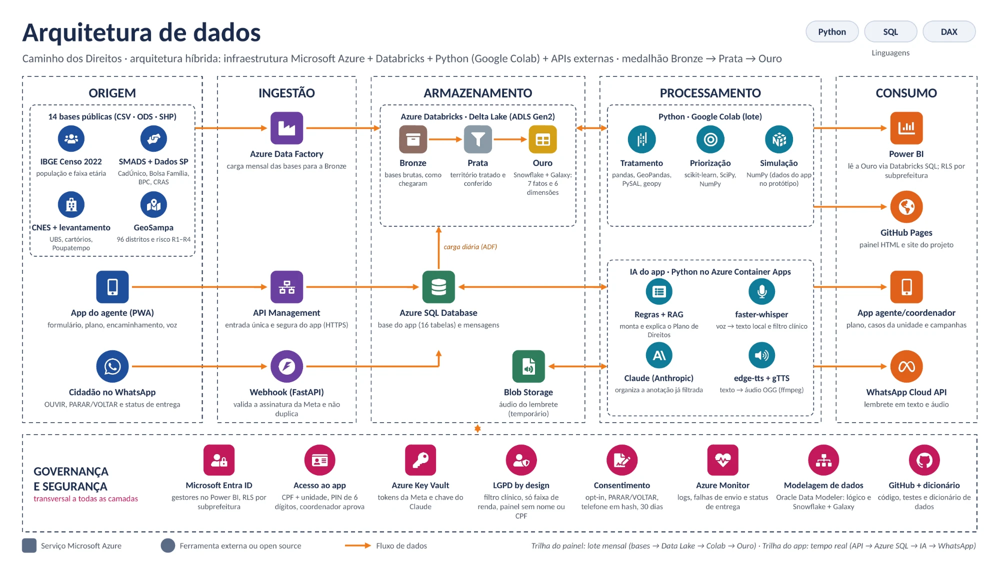
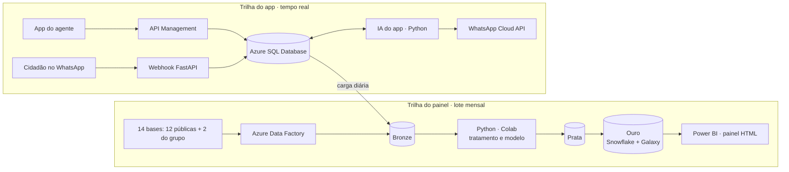

# 🏗️ Arquitetura de dados

A arquitetura do **Caminho dos Direitos** é **híbrida**: a infraestrutura roda na **Microsoft Azure** com **Azure Databricks**, o processamento e os modelos são feitos em **Python** (Google Colab) e a solução usa APIs externas onde elas são a melhor opção (WhatsApp Cloud API da Meta e Claude, da Anthropic). Os dados são organizados em **camadas medalhão** (Bronze → Prata → Ouro).

  

> **Como ler:** da esquerda para a direita, **Origem → Ingestão → Armazenamento → Processamento → Consumo**. A **Governança e segurança** atravessa todas as camadas. Ícone **quadrado** = serviço da Microsoft Azure · ícone **redondo** = ferramenta externa ou open source.

---

## 📌 Sumário

- [Duas trilhas](#-duas-trilhas)
- [Camada por camada](#-camada-por-camada)
- [Camadas medalhão](#-camadas-medalhão)
- [Governança e segurança](#-governança-e-segurança)
- [Do protótipo à produção](#-do-protótipo-à-produção)
- [Decisões de arquitetura](#-decisões-de-arquitetura)

---

## 🔀 Duas trilhas

A arquitetura segue as mesmas duas trilhas dos [notebooks](../notebooks/):

- **Trilha do painel (lote, mensal):** as bases públicas entram no lakehouse, são tratadas e conferidas, passam pelo modelo de priorização e viram o modelo dimensional que o painel lê.
- **Trilha do app (tempo real):** o atendimento do agente é gravado na hora, a IA organiza a anotação e gera o lembrete, e o cidadão recebe e responde pelo WhatsApp.
- **Onde as trilhas se encontram:** todo dia o banco do app é carregado na camada Bronze. Assim, os dados do app, que hoje são **simulados**, passam a ser **reais** no painel, sem mudar o modelo de dados.

---

## 🧱 Camada por camada

### 1. Origem

Na origem há dois tipos de dado: **o que já existe** (bases públicas) e **o que a própria solução passa a gerar** (o atendimento no app e a resposta do cidadão no WhatsApp).

| Fonte | O que traz |
|---|---|
| **IBGE, Censo 2022** | População total e por faixa etária |
| **SMADS e Portal de Dados Abertos SP** | CadÚnico, Bolsa Família, BPC e CRAS |
| **CNES e levantamento do grupo** | UBS, cartórios de registro civil e postos do Poupatempo |
| **GeoSampa** | Limites dos 96 distritos e setores de risco R1–R4 |
| **App do agente (PWA)** | Casos, Plano de Direitos, situação de cada direito, encaminhamentos e anotação por voz |
| **Cidadão no WhatsApp** | Toque em "Ouvir em áudio", PARAR / VOLTAR e status de entrega (enviada, entregue, lida, falhou) |
| **Pesquisa exploratória do grupo** | Respostas de moradores e profissionais da linha de frente (Google Forms), pseudonimizadas com SHA-256. Orientou a escolha do tema; **não alimenta o painel** ([`pesquisa/`](../pesquisa/README.md)) |

> São 14 bases: 12 públicas e 2 levantamentos do grupo (cartórios e Poupatempo), listadas nas [Referências](../README.md#-referências). Uma delas, crianças de até 5 anos sem registro (IBGE/SIDRA), é usada só na apresentação, fora do painel.

### 2. Ingestão

| Ferramenta | Tipo | Papel |
|---|---|---|
| **Azure Data Factory** | Azure | Carga mensal das 14 bases (12 públicas e 2 do grupo) na Bronze e carga diária do banco do app |
| **Azure API Management** | Azure | Entrada única e segura do app (HTTPS, autenticação e limite de requisições) |
| **Webhook (FastAPI)** | Open source | Recebe os eventos da Meta, valida a assinatura `X-Hub-Signature-256` e descarta mensagens repetidas pelo `wamid` |

### 3. Armazenamento

| Ferramenta | Tipo | O que guarda |
|---|---|---|
| **Azure Databricks · Delta Lake (ADLS Gen2)** | Azure | Lakehouse com as camadas Bronze, Prata e Ouro |
| **Azure SQL Database** | Azure | Base operacional do app: as 16 tabelas do [modelo lógico](../modelagem/2_logico/) e as mensagens do WhatsApp |
| **Azure Blob Storage** | Azure | Áudio do lembrete (OGG), temporário. O áudio da anotação do agente **não é guardado** |

### 4. Processamento

**Python · Google Colab (lote)**

| Etapa | Notebook | Bibliotecas |
|---|---|---|
| Tratamento | [`Tratamento_GS_v6`](../notebooks/Tratamento_GS_v6.ipynb) | pandas, GeoPandas, PySAL (esda, libpysal), geopy, scikit-learn, statsmodels |
| Priorização | [`Modelo_GS_v4`](../notebooks/Modelo_GS_v4.ipynb) | scikit-learn (Random Forest, Gradient Boosting e regressão Ridge), SciPy, NumPy |
| Simulação do app | [`Simulacao_App_v2`](../notebooks/Simulacao_App_v2.ipynb) | NumPy, pandas (só enquanto o app não está em operação). Gera casos, documentos e encaminhamentos com as datas de um piloto de 04/05 a 13/11/2026 |
| Dados das páginas HTML | [`gerar_dados_painel.py`](../dashboard/gerar_dados_painel.py) e [`gerar_dados_site.py`](../site/gerar_dados_site.py) | Python puro (csv, json): leem os CSVs da camada Ouro e geram `dados_painel.js` e `dados_site.js` |

**IA do app · Python no Azure Container Apps (tempo real)**

| Módulo | Ferramenta | O que faz |
|---|---|---|
| Plano de Direitos | Motor de regras + RAG | Monta o plano com os 7 programas e explica em linguagem simples, citando as fontes |
| Anotação por voz | **faster-whisper** (local) | Transcreve a fala do agente, apaga o áudio e remove dado clínico |
| Organização da anotação | **Claude (Anthropic)** | Recebe **só o texto já filtrado** e sugere marcações que o agente confirma |
| Lembrete em áudio | **edge-tts** + gTTS (reserva) + ffmpeg | Gera a mensagem de voz em OGG/Opus, o formato de áudio do WhatsApp |

Código: o motor de regras e o RAG estão em [`notebooks/simulador/`](../notebooks/simulador/); a anotação por voz, a voz e o WhatsApp, em [`notebooks/ia/`](../notebooks/ia/) (`anotacoes.py`, `whatsapp.py`, `voz.py` e `servidor_whatsapp.py`).

### 5. Consumo

| Ferramenta | Para quem | O que entrega |
|---|---|---|
| **Power BI** | Gestor público | Painel do monitoramento com as abas **Gestão** (metas e evolução no tempo) e **Operação** (quem está esperando e há quanto tempo), lendo a camada Ouro pelo Databricks SQL, com segurança por linha (RLS) por subprefeitura |
| **GitHub Pages** | Banca e público | [Painel HTML](https://karen-akemi.github.io/Caminho_dos_direitos/) (mesmas abas do Power BI) e [site do projeto](https://karen-akemi.github.io/Caminho_dos_direitos/indexsite.html), com a plataforma de demonstração por cargo (secretaria, subprefeitura, coordenação e agente) |
| **App agente/coordenador** | Agente e coordenador | Plano de Direitos, casos da unidade e campanhas recomendadas |
| **WhatsApp Cloud API (Meta)** | Cidadão | Lembrete do encaminhamento em texto (mensagem-modelo) com o botão "Ouvir em áudio" e mensagem de voz |

---

## 🥉🥈🥇 Camadas medalhão

| Camada | O que tem | Equivale hoje a |
|---|---|---|
| **Bronze** | Bases brutas, do jeito que chegaram, e a cópia diária do banco do app | Pasta `Dados` do Drive |
| **Prata** | Território tratado e conferido: nomes de distrito padronizados, join espacial, 96 distritos sem repetição | [`dados/saida/`](../dados/saida): `distritos_base`, `fato_acesso_distrito_servico`, `fato_beneficios_distrito` e `kpi_cidade` |
| **Ouro** | Modelo dimensional **Snowflake + Galaxy**: 8 fatos e 6 dimensões, pronto para o painel. A `dim_tempo` (calendário) é criada no Power BI e liga a abertura do caso, o encaminhamento e a identificação do documento | [`dados/saida_modelo/`](../dados/saida_modelo), [`dados/saida_app/`](../dados/saida_app) e, de [`dados/saida/`](../dados/saida), `dim_distrito`, `dim_subprefeitura`, `dim_equipamento` e `fato_risco_setor` |

As conferências do tratamento (96 distritos, população somada igual ao Censo, as duas bases do CadÚnico iguais) são a porta de entrada da Prata: dado que não passa nelas não sobe de camada.

---

## 🛡️ Governança e segurança

A governança vale para todas as camadas, com **LGPD by design**.

| Item | Ferramenta | O que garante |
|---|---|---|
| Identidade dos gestores | **Microsoft Entra ID** | Login no Power BI e segurança por linha: cada gestor vê só a sua subprefeitura |
| Acesso ao app | Regra do app | CPF + unidade (UBS/CRAS), PIN de 6 dígitos ou código por WhatsApp; o coordenador aprova cada pedido |
| Segredos | **Azure Key Vault** | Tokens da Meta e chave do Claude fora do código (hoje ficam nos Secrets do Colab) |
| Proteção de dados | Regras de LGPD | Filtro de dado clínico, só a faixa de renda (nunca o valor), `dim_caso` sem nome, apelido ou CPF |
| Consentimento | Regras do WhatsApp | Opt-in registrado, PARAR / VOLTAR, telefone guardado como hash, conversas apagadas em 30 dias, limite de envios por pessoa |
| Monitoramento | **Azure Monitor** | Logs, alertas de falha nas cargas e de falha de envio, status de entrega |
| Modelagem de dados | **Oracle SQL Developer Data Modeler** | Desenho da estrutura: [conceitual](../modelagem/1_conceitual/) → [lógico](../modelagem/2_logico/) → [dimensional Snowflake + Galaxy](../modelagem/3_dimensional/) |
| Versionamento e documentação | **GitHub** | Código, testes do motor de regras e [dicionário de dados](../modelagem/dicionario_dados.md) com a rastreabilidade tela do app → tabela → quadro do painel |

---

## 🚀 Do protótipo à produção

O que já foi construído e como cada peça roda quando a solução estiver em operação. O código Python e o modelo de dados são os mesmos; muda onde cada peça roda.

| Camada | Hoje (o que construímos) | Em operação |
|---|---|---|
| Ingestão | Download das 14 bases para o Google Drive (pasta `Dados`) | Azure Data Factory, carga mensal na Bronze |
| Armazenamento | Google Drive: `Dados`, `saida`, `saida_modelo` e `saida_app` | Azure Databricks (Delta Lake no ADLS Gen2): Bronze, Prata e Ouro |
| Processamento | Notebooks Python no Google Colab (Executar tudo) | Mesmo código Python, lendo e gravando no lakehouse |
| Dados do app | Simulados no `Simulacao_App_v2`, calibrados nos dados reais | Reais: Azure SQL carregado todo dia na Bronze |
| Banco do app | Modelo lógico no Oracle Data Modeler e SQLite no servidor do WhatsApp | Azure SQL Database (script gerado pelo Data Modeler) |
| IA e WhatsApp | Módulos `ia/` no Colab, expostos pelo Cloudflare Tunnel | FastAPI no Azure Container Apps, com URL fixa |
| Segredos | Secrets do Colab | Azure Key Vault |
| Painel | Power BI Desktop ([`dashboard/`](../dashboard/): `Caminho-dos-direitos.pbix` e `caminho-dos-direitos-dashboard-v2.pbix`) e HTML no GitHub Pages, com dados gerados pelos scripts `gerar_dados_*.py` | Power BI Service com RLS e HTML no GitHub Pages, com a `dim_tempo` como tabela da camada Ouro |
| App | Protótipo navegável no Figma | PWA para agente e coordenador |

---

## 🧭 Decisões de arquitetura

- **Por que Azure?** O painel já é Power BI. Com a Azure, o login dos gestores (Entra ID), a segurança por linha e o painel ficam no mesmo ecossistema.
- **Por que híbrida?** O tratamento, o modelo e a IA já foram desenvolvidos e testados em Python no Colab. Levar o mesmo código para a nuvem evita reescrever o que funciona. A WhatsApp Cloud API é o canal oficial da Meta, e o Claude é usado só para organizar texto já filtrado.
- **Por que Databricks no armazenamento?** O Delta Lake dá as camadas Bronze, Prata e Ouro com histórico de versões, e o Databricks SQL entrega a camada Ouro direto ao Power BI.
- **Por que Azure SQL para o app?** O app grava cada caso e cada encaminhamento na hora, e precisa de um banco transacional. O lakehouse fica para a análise.
- **Por que o Oracle Data Modeler aparece na governança?** Ele é a ferramenta de **modelagem**, não de armazenamento nem de processamento: define a estrutura do banco do app e da camada Ouro e gera o script de criação das tabelas. Os scripts do projeto estão em Oracle 19c; para o Azure SQL, o mesmo modelo é exportado pelo Data Modeler no formato do SQL Server.
- **Por que a transcrição é local?** O faster-whisper roda no próprio servidor, então o áudio do agente não sai da infraestrutura do projeto e é apagado logo depois da transcrição.

---

  <a href="../README.md">← Voltar para o README principal</a>

