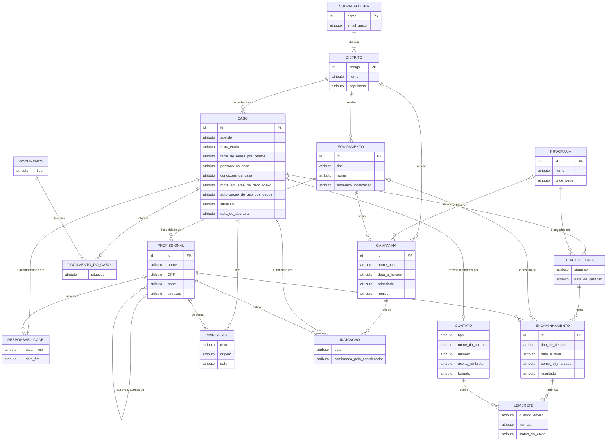

# Modelo conceitual — Caminho dos Direitos

O modelo conceitual descreve **o que o app registra** quando o agente comunitário de saúde ou o assistente social acompanha uma pessoa, e quais informações de referência (território e catálogos) ele usa. É o primeiro passo da modelagem: daqui saem as tabelas do modelo dimensional (Snowflake + Galaxy) que alimentam o painel no Power BI.

```
Telas do app  →  Modelo conceitual  →  Modelo dimensional  →  Painel do monitoramento
```

## Diagrama


<details>
<summary>Versão em Mermaid (renderizada pelo GitHub)</summary>


</details>

Notação: `1` exatamente um · `0..1` zero ou um · `0..N` zero ou muitos · `1..N` um ou muitos. Atributo sublinhado = identificador.

## Entidades

### Referência (território e catálogos)

| Entidade | O que representa | Onde aparece no app |
|---|---|---|
| **Subprefeitura** | Divisão administrativa da cidade; cada uma tem um gestor que vê só os seus dados | Painel (filtro e segurança por gestor) |
| **Distrito** | Um dos 96 distritos de São Paulo | Etapa 1 (distrito onde mora), Campanhas |
| **Equipamento** | Serviço público com endereço: UBS, CRAS, cartório ou Poupatempo. UBS e CRAS também são a **unidade** onde o profissional trabalha | Pedir acesso, Registrar encaminhamento, Campanhas |
| **Programa** | Os 7 direitos que o app sugere: Documentação básica, CadÚnico, Bolsa Família, BPC, Tarifa Social de Energia, Pé-de-Meia, Farmácia Popular | Plano de Direitos |
| **Documento** | Catálogo de documentos: certidão de nascimento, RG/CIN, CPF, comprovante de residência, título de eleitor, carteira de trabalho | Etapa 3 |

### Operação do app

| Entidade | O que representa | Onde aparece no app |
|---|---|---|
| **Profissional** | Agente comunitário de saúde, assistente social ou coordenador da unidade | Pedir acesso, Equipe |
| **Caso** | Uma pessoa acompanhada (cada caso é uma pessoa). Guarda só apelido, faixas e condições — sem nome completo nem CPF. Inclui se mora em área de risco R3/R4 (agravante) | Novo atendimento (etapas 1 a 3), Casos |
| **Responsabilidade** | Período em que um profissional acompanha um caso; guarda o histórico quando o caso é transferido | Casos da unidade, Desligar e transferir |
| **Contato** | Número de WhatsApp para lembretes (da própria pessoa ou de um familiar) e o formato preferido | Etapa 1 (contato para lembretes) |
| **Documento do caso** | Se a pessoa tem, não tem ou não sabe se tem cada documento | Etapa 3, Documentação básica |
| **Item do plano** | Um direito sugerido para o caso, com a situação marcada pelo agente | Plano de Direitos, Detalhe do direito |
| **Encaminhamento** | Ida da pessoa a um serviço para resolver um item do plano, com data e resultado | Registrar encaminhamento, Acompanhamento do caso |
| **Lembrete** | Mensagem de WhatsApp (texto, áudio ou os dois) enviada antes do atendimento | Registrar encaminhamento (conversa com o cidadão) |
| **Marcação** | Observação sobre o caso (ex.: "dificuldade para ir sozinha"), sugerida pela IA a partir da anotação por voz ou digitada, sempre confirmada pelo profissional | Anotação por voz com IA, Acompanhamento do caso |
| **Campanha** | Ação coletiva recomendada para um distrito de prioridade urgente ou alta (ex.: mutirão de Bolsa Família) | Campanhas |
| **Indicação** | Caso indicado para participar de uma campanha | Campanhas (indicar casos à busca ativa) |

## Relacionamentos e cardinalidades

| Relacionamento | Cardinalidade | Justificativa |
|---|---|---|
| Subprefeitura **agrupa** Distrito | 1 : 1..N | Todo distrito pertence a uma subprefeitura; toda subprefeitura tem ao menos um distrito |
| Distrito **contém** Equipamento | 1 : 0..N | Cada serviço fica em um distrito; há distritos sem algum tipo de serviço |
| Equipamento **é a unidade de** Profissional | 1 : 0..N | O profissional pede acesso informando uma única unidade (UBS ou CRAS) |
| Profissional **aprova o acesso de** Profissional | 0..1 : 0..N | Autorrelacionamento: o coordenador aprova os pedidos da sua unidade; o primeiro acesso da unidade não tem aprovador no app |
| Distrito **é onde mora** Caso | 1 : 0..N | Pergunta da etapa 1 |
| Caso **é acompanhado em** Responsabilidade | 1 : 1..N | Todo caso tem um responsável; se for transferido, ganha um novo período e o antigo fica no histórico |
| Profissional **assume** Responsabilidade | 1 : 0..N | Um profissional acompanha vários casos |
| Caso **recebe lembretes por** Contato | 1 : 0..1 | Quem não tem WhatsApp não tem contato; o lembrete fica com o agente |
| Caso **informa** Documento do caso / Documento **classifica** | 1 : 0..N / 1 : 0..N | Relação N:M entre Caso e Documento, resolvida por uma entidade associativa com a situação (tem, não tem, não sabe) |
| Caso **tem no plano** Item do plano / Programa **é sugerido em** | 1 : 1..N / 1 : 0..N | Relação N:M entre Caso e Programa; ao concluir o atendimento o app gera ao menos uma sugestão |
| Item do plano **gera** Encaminhamento | 1 : 0..N | Um direito pode precisar de mais de uma ida (ex.: faltou e remarcou) |
| Equipamento **é destino de** Encaminhamento | 0..1 : 0..N | Opcional: o INSS é atendido por telefone ou app, sem equipamento físico |
| Profissional **registra** Encaminhamento | 1 : 0..N | Quem registrou fica salvo, mesmo se o caso for transferido depois |
| Encaminhamento **agenda** Lembrete | 1 : 0..N | O agente escolhe quando enviar (2 dias antes, 1 dia antes, no dia); sem contato, nenhum lembrete |
| Contato **recebe** Lembrete | 1 : 0..N | O lembrete vai para o número cadastrado, que pode ser de um familiar |
| Caso **tem** Marcação / Profissional **confirma** | 1 : 0..N / 1 : 0..N | A IA só sugere; nada é salvo sem confirmação do profissional |
| Distrito **recebe** Campanha | 1 : 0..N | Campanhas são territoriais |
| Programa **é foco de** Campanha | 0..1 : 0..N | Opcional: algumas ações valem para todos os programas |
| Equipamento **sedia** Campanha | 0..1 : 0..N | Opcional: a campanha pode acontecer fora de um equipamento |
| Campanha **recebe** Indicação / Caso **é indicado em** / Profissional **indica** | 1 : 0..N (cada) | Relação N:M entre Caso e Campanha, com quem indicou e a confirmação do coordenador |

## Regras de negócio

1. Cada caso é **uma pessoa**; o app guarda apelido, nunca nome completo nem CPF.
2. A renda é digitada só na calculadora; o app guarda apenas a **faixa de renda por pessoa** (até R$ 218, 405, 810, 1.621, acima ou não informado).
3. Um caso tem **um responsável por vez**; ao desligar um profissional, os casos são transferidos e o histórico é mantido.
4. Encaminhamento **concluído** muda a situação do item do plano para **"Já recebe"**; na Documentação básica, o documento deixa de estar pendente.
5. Quem recebe Bolsa Família, BPC ou Tarifa Social **tem CadÚnico** (no máximo "Precisa atualizar").
6. Lembrete só é enviado se o caso tiver contato e a pessoa **aceitar** receber.
7. A IA **não guarda áudio, transcrição nem dados clínicos**: só ficam as marcações confirmadas.
8. Campanhas só são recomendadas para distritos de prioridade **urgente ou alta**.

## Consistência com os dados e o Power BI

Cada coluna das tabelas do app no Power BI (e nos arquivos de [`dados/saida_app`](../../dados/saida_app)) vem de uma entidade do modelo conceitual, direto ou por uma regra simples aplicada na carga:

| Coluna no Power BI | Vem de | Regra |
|---|---|---|
| `dim_caso.id_caso`, `faixa_etaria`, `faixa_renda`, `situacao_caso`, `area_risco_r3r4` | Caso | direto |
| `dim_caso.cod_distrito` | Caso → Distrito (onde mora) | direto |
| `dim_caso.id_unidade` | Responsabilidade atual → Profissional → Equipamento | unidade do profissional responsável hoje |
| `dim_caso.whatsapp` | Contato | tipo do WhatsApp; **Sem WhatsApp** quando o caso não tem contato |
| `dim_caso.aceita_lembrete`, `formato_lembrete` | Contato | **Sem como receber** quando o caso não tem contato |
| `dim_caso.faixa_etaria_ordem`, `faixa_renda_ordem` | Caso | ordem para classificar no gráfico |
| `fato_item_plano` (`situacao`, `situacao_ordem`) | Item do plano | direto |
| `fato_documento_pendente.documento` | Documento do caso | só os documentos com situação **não tem** |
| `fato_encaminhamento` (`tipo_destino`, `resultado`) | Encaminhamento | direto |
| `fato_encaminhamento.lembrete_enviado`, `formato_lembrete` | Lembrete | **Sim** se algum lembrete do encaminhamento foi enviado, com o formato usado |
| `fato_recomendacoes` | Campanha | a campanha nasce da recomendação do modelo de prioridade e aparece no app (tela Campanhas) |
| `dim_programa`, `dim_distrito`, `dim_equipamento`, `dim_subprefeitura` | Programa, Distrito, Equipamento, Subprefeitura | atributos de território (área, população, densidade, `eh_unidade_app`, `tem_dado_publico_por_distrito`) vêm das bases públicas no tratamento |
| `grupo_lembrete`, `categoria_lembrete` | — | colunas calculadas no Power BI |
| `origem` | — | marca da carga: REAL, SIMULADO ou ESTIMATIVA DO MODELO |

Profissional, Responsabilidade (histórico), Marcação, Indicação, nome do contato e número de WhatsApp **não vão para o painel**: são dados pessoais ou operacionais e ficam só no banco do app (LGPD).

## Do conceitual ao modelo dimensional

| Entidade (conceitual) | Tabela no modelo dimensional / Power BI |
|---|---|
| Subprefeitura, Distrito, Equipamento, Programa | `dim_subprefeitura`, `dim_distrito`, `dim_equipamento`, `dim_programa` |
| Caso + Contato (só tipo, aceite e formato) | `dim_caso` |
| Item do plano | `fato_item_plano` |
| Documento do caso (situação "não tem") | `fato_documento_pendente` |
| Encaminhamento + Lembrete (enviado e formato) | `fato_encaminhamento` |
| Campanha | `fato_recomendacoes` |
| Profissional, Responsabilidade, Marcação, Indicação, número do contato | Ficam só no banco do app (dados pessoais e operacionais, LGPD) |

Os dados territoriais do painel (`fato_indicadores_distrito`, `fato_risco_setor`) vêm de bases públicas e não passam pelo app; o encontro entre as duas origens acontece no **Distrito**.
