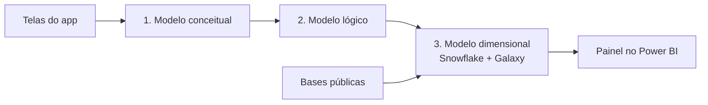
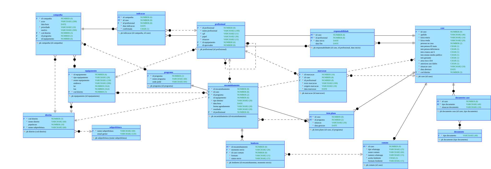
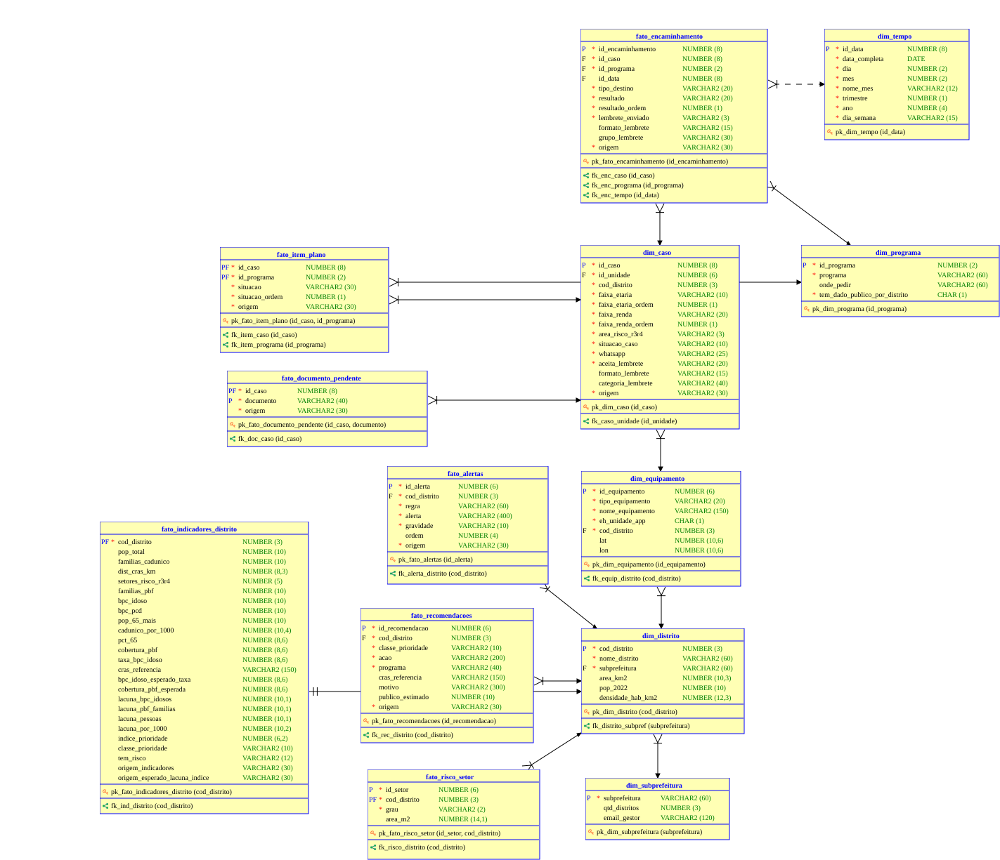

# 🧩 Modelagem de dados

Como os dados do **Caminho dos Direitos** são organizados: do que o agente registra no app até o que o gestor vê no *Painel do monitoramento*.



## Duas origens, um modelo

O painel junta duas fontes de dados, separadas pela coluna `origem` em todas as tabelas:

| Origem | O que é | Exemplos |
|---|---|---|
| **REAL** | Bases públicas tratadas | população e CadÚnico por distrito, Bolsa Família, BPC, UBS, CRAS, setores de risco |
| **ESTIMATIVA DO MODELO** | Calculado pelo modelo de priorização | cobertura esperada, lacuna, índice de prioridade, campanhas recomendadas |
| **SIMULADO** | O que os agentes registrariam no app, gerado a partir dos dados reais de cada distrito | casos, Plano de Direitos, documentos que faltam, encaminhamentos, lembretes |

As duas partes se encontram no **distrito**. Quando o app estiver em uso, o modelo não muda: as tabelas do app passam a receber dados reais e só a `origem` muda.

## 1. Modelo conceitual

O que o app registra: 16 entidades, 25 relacionamentos e as regras de negócio, cada uma ligada à tela do protótipo onde aparece.


📄 [Entidades, cardinalidades e regras de negócio](1_conceitual/modelo_conceitual.md)

## 2. Modelo lógico

O modelo conceitual com chaves e tipos, feito no Oracle SQL Developer Data Modeler.



🗄️ Script para importar no Data Modeler: [`modelo_logico_app.sql`](2_logico/modelo_logico_app.sql)

## 3. Modelo dimensional (Snowflake + Galaxy)

- **Galaxy (constelação de fatos):** 7 tabelas fato com grãos diferentes (pessoa, encaminhamento, distrito, setor de risco) que compartilham dimensões.
- **Snowflake:** a hierarquia territorial é normalizada (subprefeitura → distrito → unidade → caso) para os filtros do painel e para cada gestor ver só a sua subprefeitura.



| Grupo | Tabelas |
|---|---|
| Dimensões | `dim_subprefeitura`, `dim_distrito`, `dim_equipamento`, `dim_programa`, `dim_caso`, `dim_tempo` (proposta) |
| Fatos do território | `fato_indicadores_distrito`, `fato_recomendacoes`, `fato_risco_setor` |
| Fatos do app | `fato_item_plano`, `fato_documento_pendente`, `fato_encaminhamento` |
| Fato que cruza app e território | `fato_alertas` |

> A `dim_tempo` é uma **proposta em escala**: os dados simulados não têm data. Com o app em uso, a data do encaminhamento alimenta essa dimensão e o painel passa a mostrar a evolução.

📊 [Matriz de granularidade, matriz de barramento e decisões de modelagem](3_dimensional/matriz_granularidade_barramento.md)
🗄️ Script para importar no Data Modeler: [`modelo_dimensional.sql`](3_dimensional/modelo_dimensional.sql)

## Dicionário de dados

Todas as tabelas e colunas, com tipo, chave, descrição e valores reais, além da rastreabilidade **tela do app → tabela → quadro do painel**.

📖 [Dicionário de dados](dicionario_dados.md)

## Proteção de dados (LGPD)

Nome, CPF, telefone, dados dos profissionais e anotações ficam só no banco do app. O modelo analítico trabalha com o identificador do caso e com faixas (idade e renda por pessoa): o app nunca guarda o valor da renda.

## Arquivos desta pasta

```
modelagem/
├── README.md
├── dicionario_dados.md
├── 1_conceitual/
│   ├── modelo_conceitual.md
│   └── modelo_conceitual.png
├── 2_logico/
│   ├── modelo_logico_app.png
│   └── modelo_logico_app.sql
└── 3_dimensional/
    ├── matriz_granularidade_barramento.md
    ├── modelo_dimensional.png
    ├── modelo_dimensional.svg
    └── modelo_dimensional.sql
```

[← Voltar para o README principal](../README.md)
